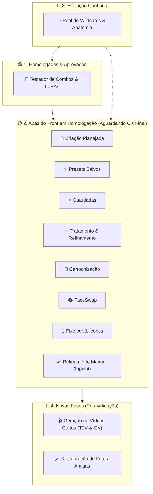

# Roadmap de Features do Estúdio IA

> **Diretriz de Ciclo de Vida**: As features atuais do frontend e módulos do estúdio precisam ser testadas pelo usuário para recebimento do OK final antes do avanço para as novas fases. O pool de wildcards permanece como uma feature viva em evolução contínua durante todo o processo.

---

## 📌 Status Atual das Funcionalidades do Frontend

---

### 1. Testador de Combos & LoRAs (`tab-tester`)
* **Status**: 🟢 **Satisfatório / Aprovado pelo Usuário**
* **Funcionalidades**:
  * Sorteio ponderado por categorias (raça, estilo, poses, fetiches/nsfw).
  * Galeria dinâmica com zoom, metadados completos e controle de densidade (Compacto, Médio, Grande).
  * Exclusão individual de imagens de teste e reteste de sementes.
  * Execução em lote estabilizada (VRAM otimizada com `--highvram`).

---

### 2. Criação Planejada (`tab-create`)
* **Status**: 🟡 **Em Ajuste / Aguardando Teste do Usuário**
* **Correções em Andamento**:
  * [ ] **Botão Delete**: Adicionar botão `🗑️ Excluir` em cada card da galeria de criação e endpoint backend `/api/creation/delete_image`.
  * [ ] **Guardar Responsivo**: Feedback visual imediato (`⭐ Guardada`), atualização do botão e integração perfeita com a galeria de guardadas.
  * [ ] **Controle AMOLED Estrito**: Correção da leitura da chave `is_amoled` / `amoled` e desvio físico do Nó SaveImage (bypassing Node 95 quando desmarcado).
  * [ ] **Steps Dinâmicos**: Ajuste de steps (10 a 60, padrão 28) integrado ao KSampler.
  * [ ] **Resolução de Checkpoints**: Casamento inteligente de nomes com subpastas do ComfyUI.

---

### 3. Presets Salvos (`tab-presets`)
* **Status**: 🟡 **Aguardando Teste do Usuário**
* **Funcionalidades a Testar**:
  * [ ] Listagem em cards com capa gerada no teste e detalhes dos LoRAs com pesos.
  * [ ] Campo de busca em tempo real (filtrar por nome do preset, modelo ou LoRAs).
  * [ ] Botão de importação direta para o Testador e para a Criação Planejada.
  * [ ] Edição de descrição personalizada e exclusão de presets.

---

### 4. Galeria de Guardadas (`tab-saved`)
* **Status**: 🟡 **Aguardando Teste do Usuário**
* **Funcionalidades a Testar**:
  * [ ] Isolamento seguro de arquivos em `tester_saved` (protegidos contra resorteios e limpezas).
  * [ ] Controles de densidade de grade e visualização em zoom fullscreen com metadados.
  * [ ] Exclusão de itens salvos e contador sincronizado no cabeçalho.

---

### 5. Tratamento & Refinamento (`tab-refine`)
* **Status**: 🟡 **Aguardando Teste do Usuário**
* **Funcionalidades a Testar**:
  * [ ] Leitura automática de metadados PNG (detecta checkpoint, LoRAs e prompts ao carregar imagem).
  * [ ] Upscale seletivo (1.0x só detalhamento, 1.5x recomendado, 2.0x ultra resolução).
  * [ ] Sliders e presets de Denoise (Fiel 0.28, Enriquecido 0.40, Remasterizar 0.54).
  * [ ] FaceDetailer e HandDetailer YOLOv8 integrados.
  * [ ] Modo de comparação lado a lado ("Comparar com Base").

---

### 6. Cartoonização (`tab-cartoon`)
* **Status**: 🟡 **Aguardando Teste do Usuário**
* **Funcionalidades a Testar**:
  * [ ] Transformação de fotos reais em arte estilizada (Disney/Pixar, Carto4on, 3D Stylized, Comics, Flatline, etc.).
  * [ ] Geração de lote de variações (3 a 5 imagens) para aprovação e feedback inteligente de pesos.
  * [ ] Sliders de calibração fina (Denoise global, peso de LoRA principal, booster e FaceDetailer anime).

---

### 7. FaceSwap (`tab-faceswap`)
* **Status**: 🟡 **Aguardando Teste do Usuário**
* **Funcionalidades a Testar**:
  * [ ] Troca de rostos com modelo InsightFace / ReActor.
  * [ ] Controle de preservação de textura da pele e iluminação do ambiente original.
  * [ ] Galeria com histórico e comparador.

---

### 8. Pixel Art & Ícones (`tab-pixelart`)
* **Status**: 🟡 **Aguardando Teste do Usuário**
* **Funcionalidades a Testar**:
  * [ ] Estilização para sprites retrô (8-bit, 16-bit, RPG Maker).
  * [ ] Remoção automática de fundo com RemBG.
  * [ ] Alternância entre paleta SFW e NSFW pixelizada.

---

### 9. Refinamento Manual / Inpaint (`tab-inpaint`)
* **Status**: 🟡 **Aguardando Teste do Usuário**
* **Funcionalidades a Testar**:
  * [ ] Canvas interativo de pintura de máscaras (pincel, espessura, borracha).
  * [ ] Inpainting seletivo guiado por prompt e Denoise calibrado.

---

## 🎨 Design System & Estética Global do Frontend
* **Status**: 🟡 **Em Refinamento**
* **Itens**:
  * [x] **Dropdowns Escuros**: Menus `<select>`, `<option>` e `<optgroup>` com fundo `#0b0f19` nativo.
  * [ ] **Checkboxes Modernos**: Substituição da aparência genérica do navegador por checkboxes estilizados no tema cyber/dark, com estados hover, checked e focus alinhados ao visual do estúdio.

---

## 🔁 Evolução Contínua: Pool de Wildcards & Anatomia

* **Status**: 🔄 **Feature em Evolução Permanente**
* **Sub-itens Integrados**:
  * **Anatomia & Raças**:
    * **Lamia**: Garantia de cauda serpentina única contínua (`single_snake_tail`), sem bifurcação ou pernas duplas.
    * **Expurgo de Dullahan**: Remoção completa de cabeças decepadas do sorteador.
    * **Arachne**: Transição para forma mais humanoide com olhos escuros e pernas traseiras.
  * **Atividades NSFW & Fetiches**:
    * **Expurgo de ChokerSnap**: Remoção de artefatos forçados de asfixia e exclusão física do LoRA.
    * **Nova Categoria `bestiality.txt`**: Integração do padrão `bestiality, interspecies, [animal], [animal]_penis, [penetration/oral], [fluids]` para caninos, equinos, felinos, répteis, etc.
    * **Tentáculos & Fisting**: Variações orais, anais, vaginais e múltiplas.
    * **Regra de Ouro**: `male_out_of_frame` preservado rigorosamente em todas as cenas com parceiro masculino.

---

## 🚀 Próximas Fases (Após Validação Completa do Frontend)

### 🎬 Fase 1: Geração de Vídeos Curtos (T2V & I2V)
* Pipelines de animação para Text-to-Video e Image-to-Video (Wan2.1 / LTX-Video / CogVideoX / AnimateDiff / SVD).
* Controles de FPS, interpolação de movimento e exportação WebM/MP4.

### 🪄 Fase 2: Restauração de Fotos Antigas
* Restauração facial generativa (CodeFormer / GFPGAN), desruído e reparo de riscos.
* Super-resolução (SUPIR / CCSR) e colorização neural para fotos P&B.
