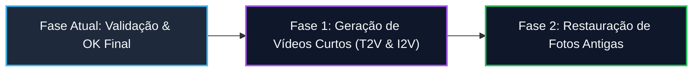

# Roadmap de Features do Estúdio IA

> **Diretriz de Ciclo de Vida**: As features atuais devem ser testadas pelo usuário para recebimento do OK final antes do avanço para as novas fases. O pool de wildcards permanece em constante evolução durante todo o processo.

---

## 📌 Status Atual das Funcionalidades

### 1. Testador de Combos & LoRAs
* **Status**: 🟢 **Satisfatório / Aprovado pelo Usuário**
* **Funcionalidades Entregues**:
  * Navegação por galeria com miniaturas e metadados completos.
  * Sorteio ponderado por categorias (raça, estilo, anatomia, fetiches/nsfw).
  * Limpeza de histórico, salvamento e reteste de sementes.
  * Execução em série estabilizada (VRAM otimizada com `--highvram`).

---

### 2. Criação Planejada
* **Status**: 🟡 **Aguardando Homologação / OK Final do Usuário**
* **Itens a Testar**:
  * [ ] Enfileiramento sem erros (correção do bug `loras is not defined`).
  * [ ] Resolução automática de subpastas de checkpoints (`waiIllustriousSDXL_v170.safetensors`).
  * [ ] Controle dinâmico de **Steps** (10 a 60, padrão 28) refletindo no Nó KSampler.
  * [ ] Aplicação correta de LoRAs selecionados com pesos customizados.

---

### 3. Interface & Usabilidade do Estúdio
* **Status**: 🟡 **Aguardando Homologação / OK Final do Usuário**
* **Itens a Testar**:
  * [ ] **Estética dos Dropdowns**: Verificação de fundo escuro (`#0b0f19`) e texto legível nos `<select>`, `<option>` e menus de prompt em todos os navegadores, sem quebra de contraste.
  * [ ] Atualização via reload (`Ctrl + F5`) refletindo os novos controles.

---

### 4. Refinamento de Prompts e Ajustes de Anatomia
* **Status**: 🟡 **Aguardando Homologação / OK Final do Usuário**
* **Itens a Testar**:
  * [ ] **Lamia**: Garantia de cauda serpentina única contínua (`single_snake_tail`), sem caudas extras ou pernas de cobra.
  * [ ] **Remoção de Dullahan**: Ausência total de headless/cabeça decepada no pool de raças.
  * [ ] **Remoção de ChokerSnap**: Remoção de artefatos de engasgo forçado indesejado e purga do LoRA do sistema.

---

## 🔄 Evolução Contínua: Pool de Wildcards

* **Status**: 🔁 **Em Desenvolvimento Contínuo**
* **Escopo Permanente**:
  * Refinamento contínuo de tags Danbooru oficiais.
  * Expansão da nova categoria `bestiality.txt` (caninos, equinos, felinos, répteis/dragão, ursos, etc.).
  * Balanceamento e ajuste de pesos para interações anatômicas complexas (tentáculos, fisting, fluidos, proporções corporais).
  * Preservação da regra `male_out_of_frame` para manter foco na protagonista feminina.

---

## 🚀 Próximas Fases (Após Validação das Atuais)

### 🎬 Fase 1: Aba de Geração de Vídeos Curtos
* **Objetivo**: Criação de animações e videoclipes de curta duração diretamente pela interface do estúdio.
* **Modalidades**:
  * **Text-to-Video (T2V)**: Geração de vídeos a partir de prompts descritivos e wildcards.
  * **Image-to-Video (I2V)**: Animação de imagens selecionadas da galeria ou via upload de imagem estática.
* **Arquitetura Prevista**:
  * Integração de pipelines de vídeo otimizados (ex: Wan2.1 / LTX-Video / CogVideoX / AnimateDiff / SVD).
  * Controles de taxa de quadros (FPS), duração (frames/segundos) e interpolação de movimento.
  * Painel de pré-visualização de vídeo e download direto em MP4/WebM.

---

### 🪄 Fase 2: Aba de Restauração de Fotos Antigas
* **Objetivo**: Recuperação de fotos e imagens com baixa resolução, ruídos, danos físicos ou sem cor.
* **Ferramentas e Pipelines**:
  * **Restauração Facial**: Integração de modelos de reconstrução facial (CodeFormer / GFPGAN).
  * **Upscaling & Desruído de Alta Definição**: Modelos de super-resolução generativa (SUPIR, CCSR, 4x-UltraSharp).
  * **Colorização Automática**: Pipelines de colorização neural para fotografias preto e branco.
  * **Remoção de Arranhões e Riscos**: Inpainting guiado por máscaras de detecção de imperfeições.
  * Comparador interativo estilo "Antes & Depois" (slider visual no frontend).
